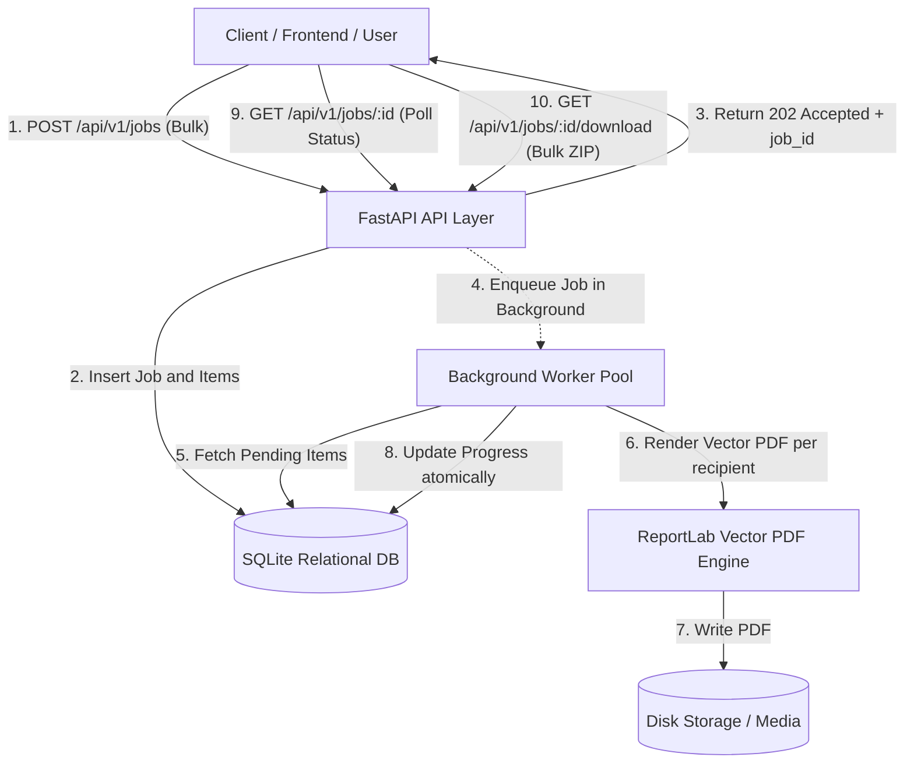

# Bulk Certificate Generator API

[](https://www.python.org/)
[](https://fastapi.tiangolo.com/)
[]()
[]()

A high-performance, fault-tolerant backend system for bulk certificate generation. Built with **FastAPI**, **ReportLab**, and **SQLAlchemy**.

---

## 📖 Table of Contents
- [Architecture Overview](#-architecture-overview)
- [How the System Works (End-to-End Workflow)](#-how-the-system-works-end-to-end-workflow)
- [How an Outer User / Client Can Use the System](#-how-an-outer-user--client-can-use-the-system)
  - [Method 1: Interactive Browser UI (Swagger Docs - Zero Code)](#method-1-interactive-browser-ui-swagger-docs---zero-code)
  - [Method 2: Programmatic Client Integration (Frontend / Script)](#method-2-programmatic-client-integration-frontend--script)
  - [Method 3: Direct File System Access](#method-3-direct-file-system-access)
- [Key Features](#-key-features)
- [Design Decisions & Justifications](#-design-decisions--justifications)
- [Project Structure](#-project-structure)
- [Quickstart Guide](#-quickstart-guide)
  - [Prerequisites](#prerequisites)
  - [Installation](#installation)
  - [Running the Server](#running-the-server)
  - [Running the Automated Tests](#running-the-automated-tests)
- [API Reference & Usage](#-api-reference--usage)
  - [1. Submit Bulk Certificate Job](#1-submit-bulk-certificate-job)
  - [2. Poll Job Status & Progress](#2-poll-job-status--progress)
  - [3. Download Individual Certificate PDF](#3-download-individual-certificate-pdf)
  - [4. Download All Certificates as ZIP](#4-download-all-certificates-as-zip)
  - [5. List Recent Jobs](#5-list-recent-jobs)
- [Interview & Architectural Q&A](#-interview--architectural-qa)

---

## 🏛 Architecture Overview



---

## ⚙️ How the System Works (End-to-End Workflow)

The bulk certificate generator is designed around **high throughput, non-blocking asynchronous execution, and fault isolation**:

1. **Step 1: Rapid Ingestion & Job Creation**
   - An external user or client submits event details along with a list of recipients (e.g. 100 or 1,000 participants).
   - FastAPI validates top-level schema syntax via **Pydantic V2**.
   - A unique `job_id` (UUID) is created and stored in the database with status `PENDING`.
   - Each recipient is assigned a unique tracking certificate identifier (e.g., `CERT-8F2A09B1-0001`).
   - The API **immediately returns `202 Accepted`** with the `job_id` and a polling URL in milliseconds, ensuring the HTTP client never times out.

2. **Step 2: Background Task Dispatch**
   - The job is dispatched to FastAPI's asynchronous background worker without blocking the main web server threads.
   - The worker marks the job status as `PROCESSING`.

3. **Step 3: Fault-Tolerant Recipient Processing Loop**
   - The worker iterates through every recipient individually within a **strict error-isolation boundary** (`try...except`):
     - **Validation Check**: Verifies that the recipient name is not empty and that the email address is syntactically valid.
     - **Generation Engine (ReportLab)**: Renders a vector PDF with certificate borders, gold seal, recipient typography, event title, date, and verification code.
     - **Storage**: Writes the PDF to a dedicated folder: `generated_certificates/{job_id}/`.
     - **Success Accounting**: Marks the recipient item as `SUCCESS`, records file path, and increments `job.success_count`.
   - **If a recipient fails** (e.g., invalid email format or rendering exception):
     - The item is marked `FAILED` with the exact error message recorded.
     - `job.failure_count` increments.
     - **CRITICAL**: The failure does *not* throw or abort the loop—the remaining valid recipients continue generating smoothly.

4. **Step 4: Final Status Determination**
   - When all recipients have been evaluated, the worker finalizes the job status:
     - `COMPLETED` &rarr; All certificates succeeded.
     - `PARTIALLY_COMPLETED` &rarr; Some succeeded, some had errors.
     - `FAILED` &rarr; All recipients failed.

5. **Step 5: Status Polling & Retrieval**
   - The client can poll `GET /api/v1/jobs/{job_id}` at any time to inspect live progress counters and itemized results.
   - Once ready, the client can download individual certificates or request a consolidated ZIP archive containing all certificates for the event.

---

## 👤 How an Outer User / Client Can Use the System

There are 3 primary ways an outer user, evaluator, or client application interacts with the system:

### Method 1: Interactive Browser UI (Swagger Docs - Zero Code)
*Best for evaluators, interviewers, and manual testing.*

1. Start the server (or verify it is running on `http://localhost:8000`).
2. Open your web browser and navigate to: **[http://localhost:8000/docs](http://localhost:8000/docs)**.
3. **Submit a Bulk Request**:
   - Scroll to `POST /api/v1/jobs`.
   - Click **Try it out**.
   - Paste your desired event name and recipient list into the JSON editor:
     ```json
     {
       "event_name": "Drone Flight & Robotics Masterclass",
       "issuer_name": "Aereo Technologies",
       "issue_date": "October 09, 2026",
       "recipients": [
         {"name": "Alice Cooper", "email": "alice@example.com"},
         {"name": "Bob Vance", "email": "bob@example.com"}
       ]
     }
     ```
   - Click **Execute**.
   - Note the `job_id` in the response (e.g., `4f2491b8-bf7c-4374-b1e1-c3bad726530c`).
4. **Track Progress**:
   - Scroll to `GET /api/v1/jobs/{job_id}`.
   - Click **Try it out**, paste the `job_id`, and click **Execute**.
   - Inspect the live counts (`total_count`, `success_count`, `failure_count`) and individual recipient statuses.
5. **Download Certificates**:
   - To download a single certificate: Copy any recipient's `download_url` from the items list and open it in a browser tab.
   - To download all certificates in one click: Open the `zip_download_url` (e.g. `http://localhost:8000/api/v1/jobs/{job_id}/download`) to download the `.zip` archive.

---

### Method 2: Programmatic Client Integration (Frontend / Script)
*How an outer frontend (React/Vue/Mobile) or automation script integrates with the API:*

#### Step A: Submit Job
```bash
curl -X POST "http://localhost:8000/api/v1/jobs" \
  -H "Content-Type: application/json" \
  -d '{
    "event_name": "AI Systems Certification",
    "issuer_name": "Aereo Academy",
    "recipients": [
      {"name": "Jane Doe", "email": "jane@example.com"},
      {"name": "John Smith", "email": "john@example.com"}
    ]
  }'
```
*Returns `HTTP 202 Accepted`:*
```json
{
  "job_id": "9bc1135c-20f5-4674-8b63-8aa3562a9010",
  "status": "PENDING",
  "status_url": "http://localhost:8000/api/v1/jobs/9bc1135c-20f5-4674-8b63-8aa3562a9010"
}
```

#### Step B: Client Polling Loop (Python Example)
```python
import requests, time

job_id = "9bc1135c-20f5-4674-8b63-8aa3562a9010"
status_url = f"http://localhost:8000/api/v1/jobs/{job_id}"

while True:
    response = requests.get(status_url).json()
    status = response["status"]
    print(f"Status: {status} ({response['processed_count']}/{response['total_count']})")
    
    if status in ["COMPLETED", "PARTIALLY_COMPLETED", "FAILED"]:
        break
    time.sleep(1)

# Download all certificates as ZIP
if response["success_count"] > 0:
    zip_data = requests.get(response["zip_download_url"])
    with open("all_certificates.zip", "wb") as f:
        f.write(zip_data.content)
    print("Downloaded all_certificates.zip successfully!")
```

---

### Method 3: Direct File System Access
*Where to locate generated certificates on disk:*

- Whenever a job is processed, the backend organizes files into:
  ```
  generated_certificates/
  └── <job_id>/
      ├── Jane_Doe_CERT-9BC1135C-0001.pdf
      ├── John_Smith_CERT-9BC1135C-0002.pdf
      └── job_<job_id>_certificates.zip
  ```
- These files persist on disk and can be viewed or shared directly from the filesystem.

---

## ✨ Key Features

1. **Non-Blocking Bulk Ingestion**:
   - Accepts large lists of recipients in a single request and responds immediately with `202 Accepted` and a `job_id`.
2. **Strict Fault Isolation**:
   - An invalid email address, empty recipient name, or rendering failure in one item **never aborts the remaining batch**.
   - Valid recipients continue generating successfully; failed recipients are tagged with descriptive error reasons.
3. **Ultra-Fast Vector PDF Rendering**:
   - Uses **ReportLab** to generate crisp, professional A4 landscape vector certificates in <15ms per certificate.
   - Tiny storage footprint (~3KB to ~15KB per PDF).
4. **Granular Status & Progress Tracking**:
   - Live metrics per job: `total_count`, `processed_count`, `success_count`, `failure_count`.
   - Overall status dynamically transitions between `PENDING`, `PROCESSING`, `COMPLETED`, `PARTIALLY_COMPLETED`, or `FAILED`.
5. **Flexible Retrieval**:
   - Download individual certificates or download a consolidated ZIP archive for the entire batch.

---

## 💡 Design Decisions & Justifications

### 1. Why FastAPI over Django REST Framework or Flask?
- **Bulk Deserialization & Validation Speed**: FastAPI leverages **Pydantic V2** (implemented in Rust), which parses and validates arrays of hundreds of recipient objects up to 10x faster than DRF serializers with minimal memory allocation.
- **Native Background Task Runner**: FastAPI provides lightweight, non-blocking asynchronous task execution (`BackgroundTasks`) out of the box without requiring external message brokers (Redis/Celery) for local evaluation.
- **Interactive OpenAPI Documentation**: Generates interactive Swagger docs (`/docs`) automatically, making it effortless to test endpoints in a live review.

### 2. Why ReportLab for Certificate Generation?
- **Performance**: Tools like WeasyPrint or headless Chrome (Puppeteer) spin up a full browser engine, consuming 300MB+ RAM and taking 1–3 seconds per certificate.
- **ReportLab**: Renders pure vector geometry directly to PDF byte streams in **under 15 milliseconds**, allowing 1,000 certificates to generate in seconds on modest hardware.

### 3. Fault Isolation Architecture
- The background worker executes recipient generation within an isolated `try...except` boundary.
- Pre-generation validation checks recipient names and email formats.
- If a record fails, its state in `certificate_items` is marked `FAILED` with the exact validation or rendering error message, and `job.failure_count` increments. Remaining records continue without interruption.

### 4. Scalability Roadmap (Single Server to Distributed)
- **Current Setup**: SQLite + FastAPI `BackgroundTasks` (zero dependencies, single-command setup for reviewers).
- **Production Scale**:
  1. Switch `DATABASE_URL` to **PostgreSQL**.
  2. Swap `BackgroundTasks` with **Celery** or **ARQ** backed by **Redis**.
  3. Swap local disk storage with **AWS S3** or **Google Cloud Storage** with pre-signed download URLs.

---

## 📂 Project Structure

```
certifcate_builder/
├── app/
│   ├── api/
│   │   └── v1/
│   │       ├── certificates.py    # Individual certificate retrieval & download
│   │       ├── jobs.py            # Bulk job creation, status polling & zip download
│   │       └── router.py          # API v1 aggregator
│   ├── core/
│   │   ├── config.py              # Environment configuration & paths
│   │   └── database.py            # SQLAlchemy engine, session maker & lifecycle
│   ├── models/
│   │   └── certificate.py         # GenerationJob & CertificateItem ORM models
│   ├── schemas/
│   │   └── certificate.py         # Pydantic request/response schemas
│   ├── services/
│   │   ├── generator.py           # ReportLab vector certificate rendering
│   │   ├── storage.py             # File path management & ZIP packaging
│   │   └── worker.py              # Fault-tolerant background job worker
│   └── main.py                    # Application factory & OpenAPI definition
├── tests/
│   ├── conftest.py                # Test fixtures (in-memory SQLite & isolated storage)
│   ├── test_downloads.py          # PDF & ZIP download endpoint tests
│   ├── test_generator.py          # Direct ReportLab rendering unit tests
│   ├── test_jobs.py               # Job creation & validation tests
│   └── test_worker_and_fault_tolerance.py  # Fault isolation & mixed batch tests
├── requirements.txt               # Locked project dependencies
├── .gitignore
└── README.md
```

---

## 🚀 Quickstart Guide

### Prerequisites
- Python 3.10+ (tested on Python 3.12)
- pip

### Installation

1. **Clone the repository and enter directory**:
   ```bash
   cd e:/Company_Assignment/Aereo/Certifcate_Builder
   ```

2. **Create and activate a virtual environment**:
   - **Windows (PowerShell)**:
     ```powershell
     python -m venv .venv
     .\.venv\Scripts\Activate.ps1
     ```
   - **Linux / macOS**:
     ```bash
     python3 -m venv .venv
     source .venv/bin/activate
     ```

3. **Install dependencies**:
   ```bash
   pip install -r requirements.txt
   ```

### Running the Server

Start the Uvicorn development server:
```bash
uvicorn app.main:app --reload --host 0.0.0.0 --port 8000
```

Once started:
- **Interactive Swagger UI**: [http://localhost:8000/docs](http://localhost:8000/docs)
- **Alternative ReDoc UI**: [http://localhost:8000/redoc](http://localhost:8000/redoc)
- **API Health Check**: [http://localhost:8000/health](http://localhost:8000/health)

### Running the Automated Tests

Execute the complete pytest suite:
```bash
pytest -v
```

All 16 tests execute in under 1 second against isolated in-memory storage:
```
============================= test session starts =============================
tests/test_downloads.py::test_download_individual_certificate PASSED     [  6%]
tests/test_downloads.py::test_download_failed_certificate_fails PASSED   [ 12%]
tests/test_downloads.py::test_download_nonexistent_certificate_404 PASSED [ 18%]
tests/test_downloads.py::test_download_bulk_zip PASSED                   [ 25%]
tests/test_downloads.py::test_download_bulk_zip_zero_successes_fails PASSED [ 31%]
tests/test_generator.py::test_certificate_pdf_generation PASSED          [ 37%]
tests/test_generator.py::test_filename_sanitization PASSED               [ 43%]
tests/test_jobs.py::test_create_bulk_job_success PASSED                  [ 50%]
tests/test_jobs.py::test_create_bulk_job_validation_missing_fields PASSED [ 56%]
tests/test_jobs.py::test_create_bulk_job_validation_empty_event_name PASSED [ 62%]
tests/test_jobs.py::test_create_bulk_job_validation_empty_recipients PASSED [ 68%]
tests/test_jobs.py::test_get_non_existent_job_404 PASSED                 [ 75%]
tests/test_jobs.py::test_list_jobs PASSED                                [ 81%]
tests/test_worker_and_fault_tolerance.py::test_full_success_batch PASSED [ 87%]
tests/test_worker_and_fault_tolerance.py::test_fault_isolation_with_invalid_recipients PASSED [ 93%]
tests/test_worker_and_fault_tolerance.py::test_all_failed_batch PASSED   [100%]
============================== 16 passed in 0.52s =============================
```

---

## 📡 API Reference & Usage

### 1. Submit Bulk Certificate Job
Queues a new generation batch.

- **Method**: `POST`
- **URL**: `/api/v1/jobs`
- **Response Code**: `202 Accepted`

**Sample Request Body**:
```json
{
  "event_name": "Autonomous Drone Pilot Certification",
  "certificate_title": "Certificate of Excellence",
  "issuer_name": "Aereo Academy",
  "issue_date": "October 09, 2026",
  "recipients": [
    {
      "name": "Jane Doe",
      "email": "jane.doe@example.com"
    },
    {
      "name": "John Smith",
      "email": "john.smith@example.com"
    },
    {
      "name": "Invalid Recipient Example",
      "email": "not-a-valid-email"
    }
  ]
}
```

**Sample Response**:
```json
{
  "job_id": "787bb706-5386-444d-b638-b118b5f90a5e",
  "status": "PENDING",
  "event_name": "Autonomous Drone Pilot Certification",
  "total_count": 3,
  "processed_count": 0,
  "success_count": 0,
  "failure_count": 0,
  "created_at": "2026-10-09T04:45:00.123456Z",
  "updated_at": "2026-10-09T04:45:00.123456Z",
  "message": "Bulk certificate generation job queued successfully.",
  "status_url": "http://localhost:8000/api/v1/jobs/787bb706-5386-444d-b638-b118b5f90a5e"
}
```

---

### 2. Poll Job Status & Progress
Checks the real-time progress and individual results of a job.

- **Method**: `GET`
- **URL**: `/api/v1/jobs/{job_id}`
- **Response Code**: `200 OK`

**Sample Response**:
```json
{
  "job_id": "787bb706-5386-444d-b638-b118b5f90a5e",
  "event_name": "Autonomous Drone Pilot Certification",
  "certificate_title": "Certificate of Excellence",
  "issuer_name": "Aereo Academy",
  "issue_date": "October 09, 2026",
  "status": "PARTIALLY_COMPLETED",
  "total_count": 3,
  "processed_count": 3,
  "success_count": 2,
  "failure_count": 1,
  "created_at": "2026-10-09T04:45:00.123456Z",
  "updated_at": "2026-10-09T04:45:01.234567Z",
  "zip_download_url": "http://localhost:8000/api/v1/jobs/787bb706-5386-444d-b638-b118b5f90a5e/download",
  "items": [
    {
      "id": "e289bf65-ff1a-4d40-843c-62863a436215",
      "recipient_name": "Jane Doe",
      "recipient_email": "jane.doe@example.com",
      "certificate_number": "CERT-787BB706-0001",
      "status": "SUCCESS",
      "file_name": "Jane_Doe_CERT-787BB706-0001.pdf",
      "download_url": "http://localhost:8000/api/v1/certificates/e289bf65-ff1a-4d40-843c-62863a436215/download",
      "error_message": null,
      "created_at": "2026-10-09T04:45:00.123456Z",
      "updated_at": "2026-10-09T04:45:00.654321Z"
    },
    {
      "id": "a90192e4-9721-4f18-bb59-866df43c3f81",
      "recipient_name": "Invalid Recipient Example",
      "recipient_email": "not-a-valid-email",
      "certificate_number": "CERT-787BB706-0003",
      "status": "FAILED",
      "file_name": null,
      "download_url": null,
      "error_message": "Validation Error: Invalid email format: 'not-a-valid-email'",
      "created_at": "2026-10-09T04:45:00.123456Z",
      "updated_at": "2026-10-09T04:45:00.890123Z"
    }
  ]
}
```

---

### 3. Download Individual Certificate PDF
- **Method**: `GET`
- **URL**: `/api/v1/certificates/{certificate_id}/download`
- **Response**: `application/pdf` binary stream.

---

### 4. Download All Certificates as ZIP
Downloads an on-demand compressed archive containing all successfully generated certificates for the job.

- **Method**: `GET`
- **URL**: `/api/v1/jobs/{job_id}/download`
- **Response**: `application/zip` binary stream.

---

### 5. List Recent Jobs
- **Method**: `GET`
- **URL**: `/api/v1/jobs?limit=20&offset=0`
- **Response**: Array of job summaries.

---

## 🎯 Interview & Architectural Q&A

### Q1: How does your system handle 10,000 recipients in a single request?
> **Answer**:
> 1. Pydantic v2 parses and validates the payload in tens of milliseconds in Rust.
> 2. The job and recipient stubs are inserted into the database, returning `202 Accepted` immediately so the client HTTP connection never times out.
> 3. For large loads in production, the worker can chunk the records (e.g. batches of 100) and publish tasks to a Celery/Redis queue where multiple worker processes render certificates concurrently.

### Q2: What happens if the server crashes halfway through processing a job?
> **Answer**:
> Because progress is persisted after each item, items generated before the crash are marked `SUCCESS` on disk and in the DB. When recovering, an initialization or retry worker simply queries `SELECT * FROM certificate_items WHERE job_id = ? AND status = 'PENDING'` and resumes where it left off, avoiding duplicate rendering.

### Q3: Why ReportLab instead of generating HTML and converting via Puppeteer / WeasyPrint?
> **Answer**:
> Headless browsers consume ~300MB RAM each, take 1–3 seconds per document, and can easily run a server out of memory under bulk loads. ReportLab is a direct vector drawing library that generates a certificate in **~15 milliseconds** with minimal CPU and memory footprint.
